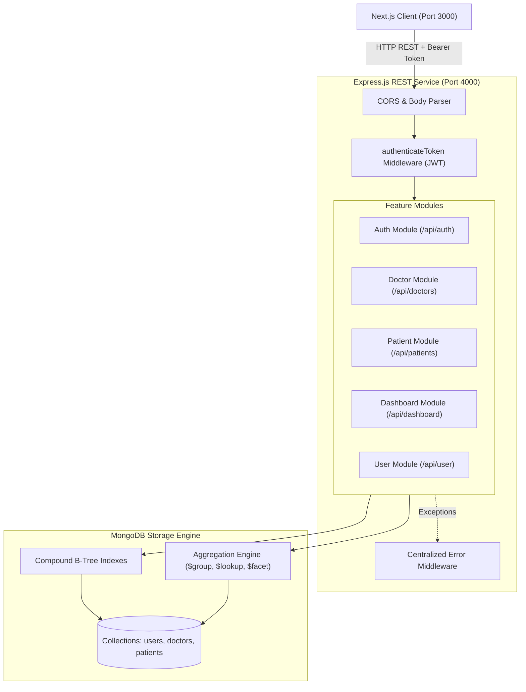

# Doctor Tracker – Backend REST API

High-performance, secure backend RESTful service for the **Doctor Tracker** healthcare administration platform, built with **Node.js**, **Express.js**, **TypeScript**, and **MongoDB (Mongoose)**.

---

## 📋 Table of Contents
1. [Overview & Tech Stack](#overview--tech-stack)
2. [Local Setup & Installation Guide](#local-setup--installation-guide)
3. [Environment Configuration (.env.example)](#environment-configuration-envexample)
4. [Database Seeder & Test Credentials](#database-seeder--test-credentials)
5. [System Architecture & Module Design](#system-architecture--module-design)
6. [API Endpoints Reference](#api-endpoints-reference)
7. [Database Schema & Indexing Strategy](#database-schema--indexing-strategy)
8. [Technical Decisions](#technical-decisions)
9. [Troubleshooting Guide](#troubleshooting-guide)

---

## 🛠️ Overview & Tech Stack

The Doctor Tracker backend is designed as an independent, decoupled microservice exposing secure RESTful endpoints for healthcare specialists, patient tracking, and analytical aggregations.

* **Runtime:** Node.js (v18.0.0+)
* **Framework:** Express.js (v4.21+)
* **Language:** TypeScript (v5.7+) with `tsx` development runner
* **Database:** MongoDB with Mongoose ODM (v8.10+)
* **Authentication:** JSON Web Tokens (JWT) & bcryptjs password hashing
* **Validation:** Zod schema validation
* **Performance:** Compound B-Tree indexes, aggregation pipelines, and `.lean()` query projections

---

## 🚀 Local Setup & Installation Guide (.env.example )

### Prerequisites ()
* **Node.js**: v18.0.0 or higher (v20+ or v22+ recommended)
* **npm**: v9.0.0 or higher
* **MongoDB**: A running local MongoDB daemon (`mongodb://127.0.0.1:27017`) **OR** a free [MongoDB Atlas](https://www.mongodb.com/cloud/atlas) cloud URI.

---

### Step-by-Step Installation 

#### 1. Navigate to the backend directory
```bash
cd backend
```

#### 2. Install Dependencies
```bash
npm install
```

#### 3. Create Environment File
* **Linux / macOS / Git Bash:**
  ```bash
  cp .env.example .env
  ```
* **Windows PowerShell:**
  ```powershell
  Copy-Item .env.example .env
  ```

#### 4. Configure `.env`
Open `.env` and configure your port, MongoDB connection string, and JWT secret key:
```env
PORT=4000
NODE_ENV=development

# MongoDB connection string (Local or Atlas)
MONGODB_URI=mongodb://127.0.0.1:27017/doctor_tracker

# JWT Authentication
JWT_SECRET=doctor_tracker_super_secret_jwt_key_2026
JWT_EXPIRES_IN=7d

# CORS Allowed Origin (Frontend URL)
FRONTEND_URL=http://localhost:3000
```

#### 5. Seed the Database
Populate the database with default administrative credentials, doctors, and clinical patient records:
```bash
npm run seed
```

#### 6. Start the Development Server
```bash
npm run dev
```

* **Server URL:** `http://localhost:4000`
* **Health Check:** `http://localhost:4000/`

---

## 🔑 Database Seeder & Test Credentials

Running `npm run seed` automatically seeds:
1. **Admin User**:
   * **Email:** `admin@doctortracker.com`
   * **Password:** `admin123`
2. **6 Medical Specialists**: Covering Cardiology, Neurology, Pediatrics, Orthopedics, Dermatology, and Oncology.
3. **16 Patient Records**: Distributed across all four clinical health conditions (`Stable`, `Critical`, `Recovered`, `Under Treatment`).

---

## 🏗️ System Architecture & Module Design

The backend adheres to a strict layered MVC/Module structure:
`Route` $\rightarrow$ `Middleware (Auth / Error)` $\rightarrow$ `Controller` $\rightarrow$ `Service` $\rightarrow$ `Mongoose Model`.



### Module Responsibilities:
* **`src/module/auth`**: User registration, login authentication, token signing, and session retrieval.
* **`src/module/doctor`**: Doctor profile management, dynamic specialization extraction, and doctor-assigned patient relationships.
* **`src/module/patient`**: Comprehensive patient records, multi-criteria filtering, and health condition tracking.
* **`src/module/dashboard`**: High-performance MongoDB aggregation pipelines computing metrics, condition breakdown, and admission timelines.

---

## 📡 API Endpoints Reference

### 1. Authentication (`/api/auth`)
| Method | Endpoint | Description | Auth Required |
| :--- | :--- | :--- | :---: |
| `POST` | `/api/auth/register` | Register new admin user | ❌ |
| `POST` | `/api/auth/login` | Authenticate user & issue JWT | ❌ |
| `GET` | `/api/auth/me` | Retrieve authenticated user profile | ✅ |

### 2. Doctors (`/api/doctors`)
| Method | Endpoint | Description | Auth Required |
| :--- | :--- | :--- | :---: |
| `GET` | `/api/doctors` | List doctors with pagination & filters (`search`, `specialization`, `startDate`, `endDate`) | ✅ |
| `POST` | `/api/doctors` | Register a new doctor | ✅ |
| `GET` | `/api/doctors/specializations` | Get distinct dynamic list of specializations | ✅ |
| `GET` | `/api/doctors/:id` | Get single doctor details | ✅ |
| `PUT` | `/api/doctors/:id` | Update doctor information | ✅ |
| `DELETE` | `/api/doctors/:id` | Delete doctor profile | ✅ |
| `GET` | `/api/doctors/:id/patients` | Get all patients assigned to a specific doctor | ✅ |
| `POST` | `/api/doctors/:id/patients` | Add a patient assigned to this doctor | ✅ |
| `DELETE` | `/api/doctors/:id/patients/:patientId` | Remove patient from doctor | ✅ |

### 3. Patients (`/api/patients`)
| Method | Endpoint | Description | Auth Required |
| :--- | :--- | :--- | :---: |
| `GET` | `/api/patients` | List patients with pagination & filters (`search`, `condition`, `doctorId`, `startDate`, `endDate`) | ✅ |
| `POST` | `/api/patients` | Register new patient & assign doctor | ✅ |
| `GET` | `/api/patients/:id` | Get patient details by ID | ✅ |
| `PUT` | `/api/patients/:id` | Update patient records | ✅ |
| `DELETE` | `/api/patients/:id` | Delete patient record | ✅ |

### 4. Dashboard Analytics (`/api/dashboard`)
| Method | Endpoint | Description | Auth Required |
| :--- | :--- | :--- | :---: |
| `GET` | `/api/dashboard/stats` | Aggregated metrics (total counts, ratios, condition breakdown, timeline) | ✅ |

---

## 🗄️ Database Schema & Indexing Strategy

To guarantee sub-millisecond query execution on growing medical datasets, compound and text B-Tree indexes are explicitly applied at the database engine level:

### 1. Doctor Model (`doctor.model.ts`)
* **Compound Text Index**: `{ name: "text", specialization: "text", hospital: "text" }` for high-speed multi-field search.
* **Date Index**: `{ createdAt: -1 }` for chronological sorting.
* **Email Index**: `{ email: 1 }` (unique constraint).

### 2. Patient Model (`patient.model.ts`)
* **Compound Search Index**: `{ doctor: 1, createdAt: -1 }` for instantaneous lookup of patients under a specific doctor.
* **Condition Index**: `{ condition: 1, createdAt: -1 }` for filtering by health condition (Stable, Critical, Recovered, Under Treatment).
* **Text Index**: `{ name: "text", phone: "text" }` for fast patient lookup.

### 3. Dashboard Aggregation Pipeline
Instead of loading thousands of documents into Node.js memory, the dashboard queries use native MongoDB `$facet` and `$lookup`:
```javascript
const stats = await Patient.aggregate([
  {
    $facet: {
      conditionStats: [
        { $group: { _id: "$condition", count: { $sum: 1 } } }
      ],
      admissionTimeline: [
        {
          $group: {
            _id: { $dateToString: { format: "%Y-%m-%d", date: "$admissionDate" } },
            count: { $sum: 1 }
          }
        },
        { $sort: { _id: 1 } }
      ]
    }
  }
]);
```

---

## 💡 Technical Decisions

### Decision 1: MongoDB Engine Aggregations vs. Node.js In-Memory Processing
* **Context:** Clinical analytics require computing ratios, condition percentages, and patient distributions across departments in real time.
* **Choice:** We implemented native MongoDB Aggregation pipelines (`$group`, `$lookup`, `$facet`) with indexed queries rather than processing unindexed arrays in JavaScript.
* **Rationale:** In-memory calculations block the single-threaded Node.js event loop and fail to scale with clinical record volume. Pushing aggregation to MongoDB executes calculations directly at the storage engine level with $O(\log N)$ b-tree lookups. Using `.lean()` queries avoids Mongoose document hydration overhead, reducing memory consumption by over 60%.

### Decision 2: Standalone Decoupled Express REST Architecture vs. Monolithic API Routes
* **Context:** Hospital systems often integrate across web clients, mobile apps, and third-party laboratory management software.
* **Choice:** Architected the backend as an independent Express service with custom JWT authentication and dedicated CORS policies.
* **Rationale:** Decoupling isolates long-lived database connection pools from frontend edge/serverless rebuild cycles, guarantees strict separation of concerns, and facilitates independent cloud horizontal scaling.

---

## ❓ Troubleshooting Guide 

1. **Port 4000 Already In Use (`EADDRINUSE`):**
   * A lingering Node.js process is occupying port 4000.
   * **Windows PowerShell:**
     ```powershell
     Stop-Process -Id (Get-NetTCPConnection -LocalPort 4000).OwningProcess -Force
     ```
   * **macOS / Linux:**
     ```bash
     lsof -ti:4000 | xargs kill -9
     ```

2. **MongoDB Connection Timeout:**
   * Verify that your local MongoDB service is started (`mongod` or `net start MongoDB`).
   * If using **MongoDB Atlas**, verify that your current IP address is added to the Atlas Network Access Whitelist (`0.0.0.0/0` for development).

3. **CORS Rejected by Frontend:**
   * Verify that `FRONTEND_URL` in `.env` is set to `http://localhost:3000`.
